# Olympus

A dark [Omarchy](https://omarchy.org) theme inspired by Greek mythology: a wine-dark Aegean night, marble text and amphora terracotta, with ten public-domain masterpieces as backgrounds — two per art movement.

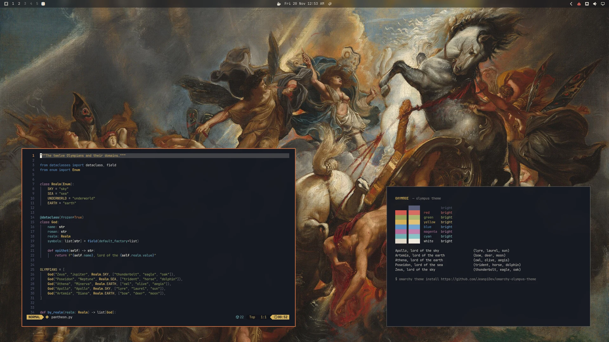

## Install

```bash
omarchy theme install https://github.com/JeanpiDev/omarchy-olympus-theme
```

## More than colors

Olympus ships its own identity, not just a palette and wallpapers:

| Piece | What it does | How it applies |
|---|---|---|
| `shell.toml` | Black-glaze bar and panels with terracotta-to-gold borders; gold for whatever is selected (menus, launcher, notifications, lock, polkit) | Automatic |
| `unlock.png` | Temple + **OLYMPUS** logo for the boot (Plymouth) and login screens | Automatic in *Appearance › Unlock*, or `omarchy plymouth set-by-theme olympus` |
| `extras/about.txt` | The Omarchy logo in *About* (fastfetch) becomes a Greek temple | Opt-in hook (below) |
| `extras/screensaver.txt` | The screensaver animates the temple and **OLYMPUS** | Opt-in hook (below) |

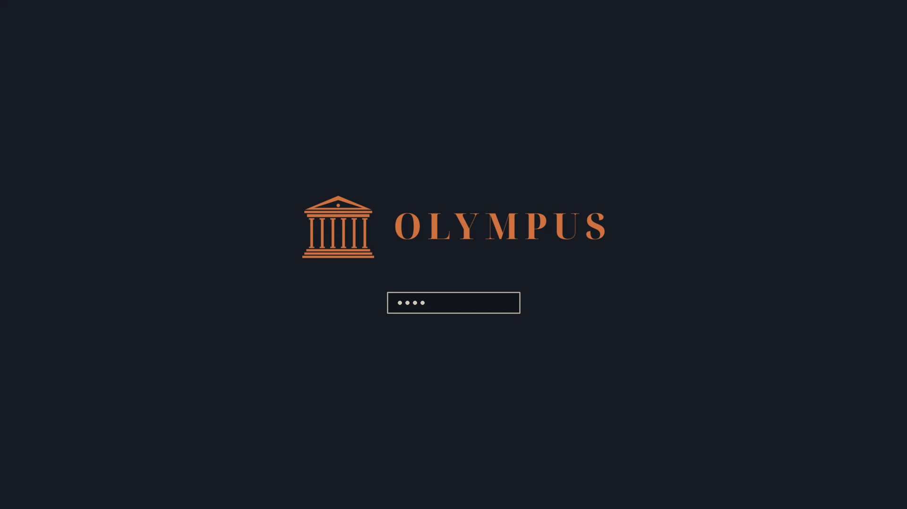


### Recommended bar

Olympus pairs well with [Shibumi Shell](https://github.com/HANCORE-linux/Shibumi-Shell), a native bar and plugin suite for Omarchy that picks up the active theme's colors on its own. Install it from its release tag following its README. `shibumi-shell uninstall --yes` (or `./scripts/shibumi-suite uninstall --yes` from a source checkout) restores the stock bar.

The preview uses this setup, all from Shibumi's Control Center:

- **Quick:** the V2 bar with the **Notch** style — a centered island under the top edge.
- **Configure › Logo:** the `omarchy` wordmark.
- **Bars:** five workspaces with the *Magic* style; the thermals and root-filesystem groups turned off.
- The music widget draws its spectrum with [`cava`](https://archlinux.org/packages/extra/x86_64/cava/) (`sudo pacman -S cava`); without it the bars stay still.

With the island bar, a smaller top gap keeps windows close to it. In `~/.config/hypr/looknfeel.lua`:

```lua
hl.config({ general = { gaps_out = { top = 2, right = 10, bottom = 10, left = 10 } } })
```

### Opt-in extras

The About and screensaver art are global in Omarchy, and installing a theme never runs code, so they come as a small `theme-set` hook you install yourself. It swaps the art in while Olympus is active and puts your previous art back when you switch to any other theme (it leaves alone anything you edited meanwhile).

```bash
bash ~/.config/omarchy/themes/olympus/extras/install.sh     # enable
bash ~/.config/omarchy/themes/olympus/extras/uninstall.sh   # remove and restore
```
The temple is drawn in `extras/src/temple.svg` and converted with `omarchy transcode ascii`.

## Palette

| Role | Color | |
|---|---|---|
| background | `#161a22` | wine-dark sea |
| foreground | `#e4ddcf` | Pentelic marble |
| accent | `#d0703f` | amphora terracotta |
| red | `#d65d52` | Ares |
| yellow | `#d9b45a` | Golden Fleece |
| orange | `#e08a4c` | Prometheus' fire |
| green | `#9aa35a` | Athena's olive |
| cyan | `#6fb3b8` | Aphrodite's sea foam |
| blue | `#5b93c7` | Poseidon / Aegean |
| magenta | `#b8709f` | Tyrian purple |

All accent colors meet WCAG AA (≥ 4.5:1) against the background.

## Wallpapers

Ten public-domain paintings, two per art movement. Click any one for the full 2560×1440 wallpaper.

<table>
<tr><td width="50%" align="center"><a href="backgrounds/01-turner-polyphemus.webp">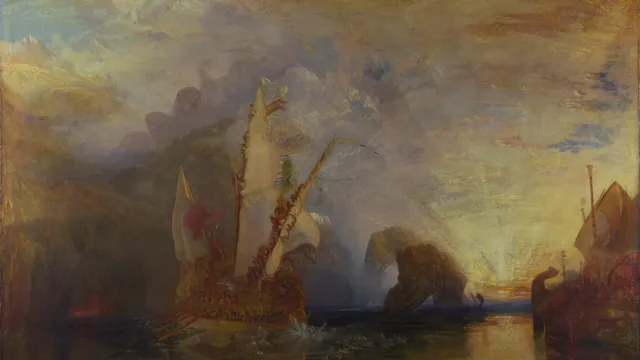</a><br><strong>Ulysses Deriding Polyphemus</strong><br><sub>J. M. W. Turner · 1829 · Romanticism</sub></td><td width="50%" align="center"><a href="backgrounds/02-turner-baiae.webp">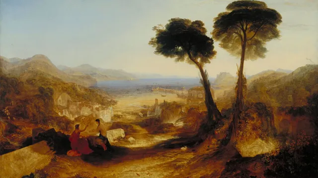</a><br><strong>The Bay of Baiae, with Apollo and the Sibyl</strong><br><sub>J. M. W. Turner · 1823 · Romanticism</sub></td></tr>
<tr><td width="50%" align="center"><a href="backgrounds/03-waterhouse-sirens.webp">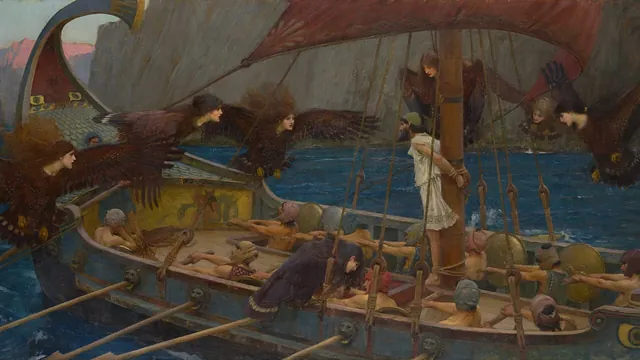</a><br><strong>Ulysses and the Sirens</strong><br><sub>J. W. Waterhouse · 1891 · Pre-Raphaelite</sub></td><td width="50%" align="center"><a href="backgrounds/04-waterhouse-narcissus.webp">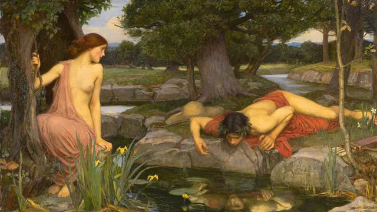</a><br><strong>Echo and Narcissus</strong><br><sub>J. W. Waterhouse · 1903 · Pre-Raphaelite</sub></td></tr>
<tr><td width="50%" align="center"><a href="backgrounds/05-botticelli-venus.webp">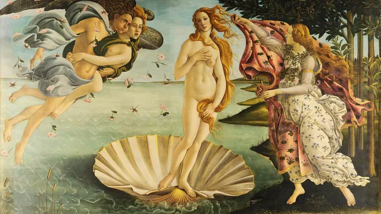</a><br><strong>The Birth of Venus</strong><br><sub>Sandro Botticelli · c. 1485 · Renaissance</sub></td><td width="50%" align="center"><a href="backgrounds/06-botticelli-primavera.webp">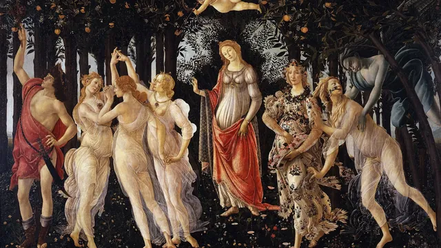</a><br><strong>Primavera</strong><br><sub>Sandro Botticelli · c. 1480 · Renaissance</sub></td></tr>
<tr><td width="50%" align="center"><a href="backgrounds/07-rubens-phaeton.webp">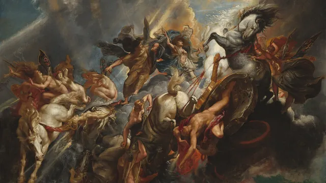</a><br><strong>The Fall of Phaeton</strong><br><sub>Peter Paul Rubens · c. 1605 · Baroque</sub></td><td width="50%" align="center"><a href="backgrounds/08-carracci-bacchus.webp">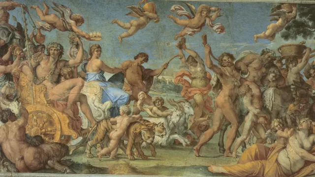</a><br><strong>The Triumph of Bacchus and Ariadne</strong><br><sub>Annibale Carracci · 1597 · Baroque</sub></td></tr>
<tr><td width="50%" align="center"><a href="backgrounds/09-bocklin-wellen.webp">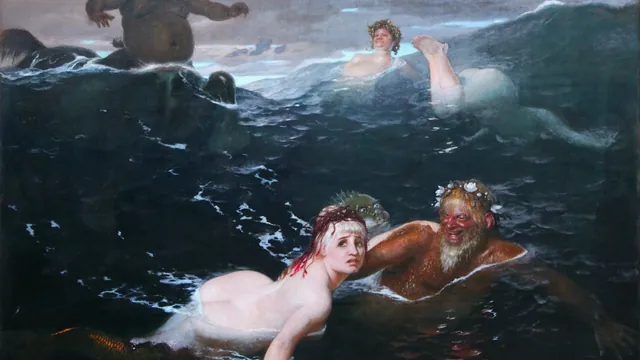</a><br><strong>Im Spiel der Wellen</strong><br><sub>Arnold Böcklin · 1883 · Symbolism</sub></td><td width="50%" align="center"><a href="backgrounds/10-bocklin-nereide.webp">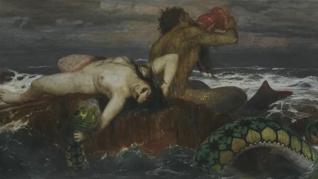</a><br><strong>Die Nereide</strong><br><sub>Arnold Böcklin · Symbolism</sub></td></tr>
</table>

Images come from Wikimedia Commons; the artworks are in the public domain. They were cropped to 16:9 (2560×1440) and lightly adjusted in brightness. Note that several classical paintings include nudity.

## License

Theme files (colors, configuration, preview composition) are released under the MIT License. The paintings are in the public domain.
