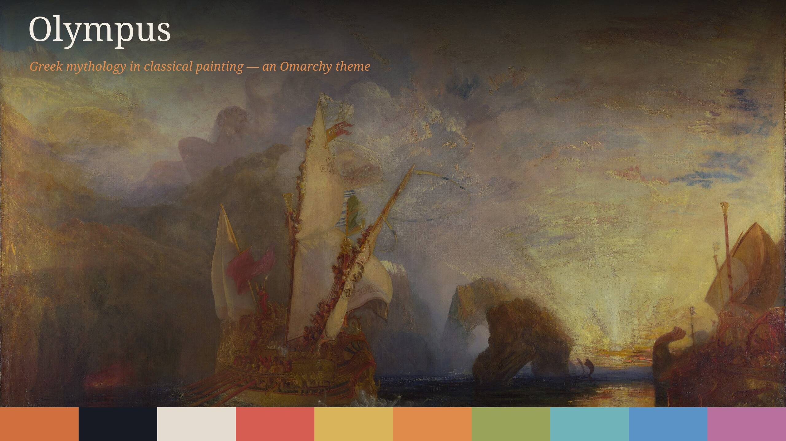

# Olympus

A dark [Omarchy](https://omarchy.org) theme inspired by Greek mythology: a wine-dark Aegean night, marble text and amphora terracotta, with ten public-domain masterpieces as backgrounds — two per art movement.



## Install

```bash
omarchy theme install https://github.com/JeanpiDev/omarchy-olympus-theme
```

## Palette

| Role | Color | |
|---|---|---|
| background | `#161a22` | wine-dark sea |
| foreground | `#e4ddcf` | Pentelic marble |
| accent | `#d0703f` | amphora terracotta |
| red | `#d65d52` | Ares |
| yellow | `#d9b45a` | Golden Fleece |
| orange | `#e08a4c` | Prometheus' fire |
| green | `#9aa35a` | Athena's olive |
| cyan | `#6fb3b8` | Aphrodite's sea foam |
| blue | `#5b93c7` | Poseidon / Aegean |
| magenta | `#b8709f` | Tyrian purple |

All accent colors meet WCAG AA (≥ 4.5:1) against the background.

## Backgrounds

| # | Movement | Work |
|---|---|---|
| 01 | Romanticism | J. M. W. Turner — *Ulysses Deriding Polyphemus* (1829) |
| 02 | Romanticism | J. M. W. Turner — *The Bay of Baiae, with Apollo and the Sibyl* (1823) |
| 03 | Pre-Raphaelite | J. W. Waterhouse — *Ulysses and the Sirens* (1891) |
| 04 | Pre-Raphaelite | J. W. Waterhouse — *Echo and Narcissus* (1903) |
| 05 | Renaissance | Sandro Botticelli — *The Birth of Venus* (c. 1485) |
| 06 | Renaissance | Sandro Botticelli — *Primavera* (c. 1480) |
| 07 | Baroque | Peter Paul Rubens — *The Fall of Phaeton* (c. 1605) |
| 08 | Baroque | Annibale Carracci — *The Triumph of Bacchus and Ariadne* (1597) |
| 09 | Symbolism | Arnold Böcklin — *Im Spiel der Wellen* (1883) |
| 10 | Symbolism | Arnold Böcklin — *Die Nereide* |

Images come from Wikimedia Commons; the artworks are in the public domain. They were cropped to 16:9 (2560×1440) and lightly adjusted in brightness. Note that several classical paintings include nudity.

## License

Theme files (colors, configuration, preview composition) are released under the MIT License. The paintings are in the public domain.
